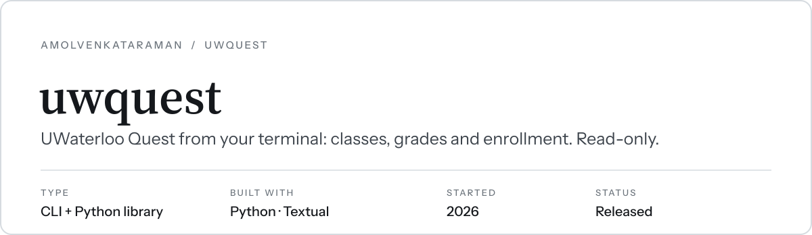

<!-- header:start -->
<div align="center">




[](https://github.com/amolvenkataraman/uwquest/blob/main/LICENSE)

[Install](#install) · [Usage](#usage) · [Terminal UI](#terminal-ui) · [How it works](#how-it-works) · [Status](#status)

</div>

<a href="https://haiscale.amolven.com/A1/"></a>

<sub>Use it only on your own account, at a modest request rate, and check UW's acceptable-use policy for automated access. Full terms: [DISCLAIMER.md](https://github.com/amolvenkataraman/uwquest/blob/main/DISCLAIMER.md)</sub>
<!-- header:end -->


<sub>The recording uses synthetic data from [`scripts/demo.py`](https://github.com/amolvenkataraman/uwquest/blob/main/scripts/demo.py); no real student record is shown.</sub>

A read-first command-line tool and Python client for **UWaterloo Quest**
(the university's PeopleSoft student self-service system).

It logs in with a browser cookie session (Quest uses SSO + Duo, which you do once
in your browser) and reads your own records into plain data — no enrolling, no
payments, and Personal-Information pages are blocked in code.

## Install

```bash
git clone https://github.com/amolvenkataraman/uwquest && cd uwquest
uv tool install .                 # base (file-based cookies)
uv tool install '.[browser]'      # also read cookies live from the browser
```

## Cookies

Log into Quest in your browser, then either:

- **Export** the `pecs.uwaterloo.ca` cookies to JSON and point the tool at it
  (`--cookies-file path.json`, or put it at `~/.config/quest/cookies.json`), or
- **Read them live** from the browser: `quest --browser brave holds`.

The session slides while you use it, so repeated commands keep it alive until
UW's SSO cap; when it expires the tool tells you to log in again.

## Usage

```bash
quest status                      # one-screen summary: program, balance, holds, next enrollment
quest schedule                    # enrolled classes this term
quest grades --term "Winter 2026" # grades (defaults to the latest term)
quest terms                       # term labels available for grades
quest account                     # per-term registration status and balance
quest holds                       # service indicators
quest milestones                  # requirements, scholarships
quest program                     # plan, academic load, campus
quest enrollment-dates            # when enrollment opens
quest financial-aid               # aid years on record
quest classes MATH 135            # course availability (status per section, no enrolling)
quest classes CS 486 --seats      # also fetch seat counts (slower)
quest classes PMATH --open-only   # whole subject, open sections only
quest transcript -o transcript.pdf  # download the unofficial transcript PDF
quest schedule --json             # raw JSON on any command (--json also works before it)
quest tui                         # interactive terminal UI (needs the 'tui' extra)
```

The transcript PDF is only *fetched* here; parsing it (GPA, averages, standing)
is a separate service. `academic-requirements` is experimental (UW renders that
report dynamically).

## Terminal UI

`quest tui` opens a tabbed interface — Dashboard, Schedule, Grades (type a term),
Account, Holds, and a Classes browser with coloured Open/Closed/Waitlist status.
Install it with the `tui` extra.

## How it works

**Session.** Quest sits behind UW's SSO and Duo, so the tool never handles a
password. `QuestSession` copies an existing browser session into a
`requests.Session`, either from an exported JSON array of cookies
(`name`/`value`/`domain`/`path`) or straight from the browser's cookie store via
`browser_cookie3`. Every request goes to the PeopleSoft content URL for one
component, `https://quest.pecs.uwaterloo.ca/psc/SS/ACADEMIC/SA/c/<COMPONENT>`,
not the portal frame around it. Each response is checked for the sign-in page
(a `cmd=login` or `/signon` URL, a sign-in title, or `userid`/`pwd` fields); if it
shows up, the call raises `SessionExpired` instead of parsing a login form.
Requests are serialised by a lock and spaced at least 0.5 s apart.
`heartbeat()` loads the landing page to keep the session sliding.

**Pages and state.** Each reader handles one component. A GET returns the page,
and the session stores that page's hidden form fields (`ICSID`, `ICStateNum` and
the rest) per component. `action()` POSTs those stored fields back with an
`ICAction` and the reader's own fields, then replaces the stored state with the
new response's, so `ICStateNum` stays in step with the server. If a component
has no state yet, it is fetched first. Where they can, parsers read PeopleSoft's
element ids (for example `STDNT_ENRL_SSV1_CRSE_GRADE_OFF$0`) rather than layout.
Some examples:

- Grades: GET the term picker, then POST its GO action with the chosen term's
  index.
- Class search: one POST of `CLASS_SRCH_WRK2_SSR_PB_CLASS_SRCH` with subject,
  number, term and career. `--seats` opens each section (`MTG_CLASS_NBR$<n>`)
  and goes back, so it costs two requests per section and stops at 40 sections.
- Transcript: `report()` selects the report type, presses View, follows the
  `/view/` link in the response and checks that the result starts with `%PDF`.

**Read-only allowlist.** `action()` POSTs only the `ICAction`s listed in
`READ_ONLY_ACTIONS` (in `core/session.py`), and each one is tied to its component:

| Component | Allowed actions |
| --- | --- |
| `UW_SS_MENU.UW_SSR_SSENRL_GRDE.GBL` (grades) | the term picker's `…PB_GO` button |
| `UW_CEM.UW_CLASS_SRCH.GBL` (class search) | `CLASS_SRCH_WRK2_SSR_PB_CLASS_SRCH`, `CLASS_SRCH_WRK2_SSR_PB_BACK`, `MTG_CLASS_NBR$<n>` |
| `SA_LEARNER_SERVICES.SSS_TSRQST_UNOFF.GBL` (transcript) | `DERIVED_SSTSRPT_TSCRPT_TYPE3`, `GO1` |

Any other action, or any action on another component, raises `BlockedAction`
before a request is sent. `report()` checks its whole sequence before it starts,
and `get()` refuses a query string that carries an `ICAction`. Nothing in the
package touches the shopping cart, enrollment, payments or any form that saves
data.

**Personal-Information blocklist.** Before any request, `get` and `action` check
the component name against
`PERSONAL|ADDR|PHONE|EMAIL|EMERG|DISABILITY|ETHNIC|GENDER|DEMOGRAPH`
(case-insensitive). A match raises `BlockedComponent` and no request is sent.
`report()` runs the same check before it starts.

## Status

Working: the session layer (file + browser cookies, the PeopleSoft request state
machine, keep-alive, a Personal-Information blocklist) and readers for status,
schedule, grades, account, holds, milestones, program, enrollment dates, financial
aid, course availability (with seat counts), and the transcript PDF, plus a
Textual TUI. All read-only; writes (enrollment) are intentionally not implemented.

## Development

```bash
uv venv .venv && uv pip install --python .venv/bin/python -e '.[dev]'
.venv/bin/pytest
.venv/bin/python scripts/demo.py account   # any command on synthetic data; no network or cookies
```

## License

MIT © 2026 Amol Venkataraman. Provided WITHOUT ANY WARRANTY — see [LICENSE](https://github.com/amolvenkataraman/uwquest/blob/main/LICENSE)
and [DISCLAIMER.md](https://github.com/amolvenkataraman/uwquest/blob/main/DISCLAIMER.md). Not affiliated with or endorsed by the
University of Waterloo or Oracle. "Quest" and "PeopleSoft" are used only to
describe compatibility.
